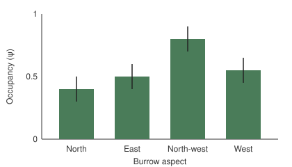

# Introduction

Bare-nosed wombats (*Vombatus ursinus*) dig deep burrows that buffer them from
the elements. In Australia, slopes that face north and
north-west receive the most winter sun, so we might expect wombats to favour
burrows with those aspects. Surveys of burrow use are complicated by
imperfect detection: a burrow can be in use without a wombat being observed [@mackenzie2002].
If detection also varies with aspect, naive counts of used burrows could
create an aspect effect where none exists, or hide a real one.

This practice note asks whether burrow occupancy differs with aspect. It
proves that wombats prefer sunny burrows.[^data]

[^data]: The numbers in this note are invented for the scrivmark tutorial.

# Methods

We visited 120 burrows three times each and recorded signs of recent use,
such as fresh scats, scratchings or spoil at the entrance. Occupancy $\psi$ and detection probability $p$ were estimated jointly,
with the probability of detecting use at least once given by

$$p^* = 1 - (1 - p)^K$$ {#eq-detect}

where $K = 3$ is the number of visits. Burrows were grouped by
the aspect of their entrance:

- north and north-west, the sunny aspects;
- east and west, the intermediate aspects.

We did not estimate abundance, although methods exist for doing so from
repeated detection data [@royle2003].

# Results

Occupancy was highest for north-west burrows (0.80) and lowest for
north-facing ones (0.40); east and west burrows fell between
(@fig-burrows; @tbl-occupancy).

{#fig-burrows}

| Aspect     | Burrows | Occupancy |
|:-----------|--------:|----------:|
| North      |      30 |      0.40 |
| East       |      30 |      0.50 |
| North-west |      30 |      0.80 |
| West       |      30 |      0.55 |

: Burrows surveyed and estimated occupancy by aspect. {#tbl-occupancy}

# Discussion

Wombats clearly prefer the sunniest aspect, which shows that thermal
benefits drive the choice of burrow. Yet north-facing burrows, which receive
similar winter sun, had the lowest occupancy, so sun exposure alone cannot
explain the pattern. Future work should test this with temperature loggers.
